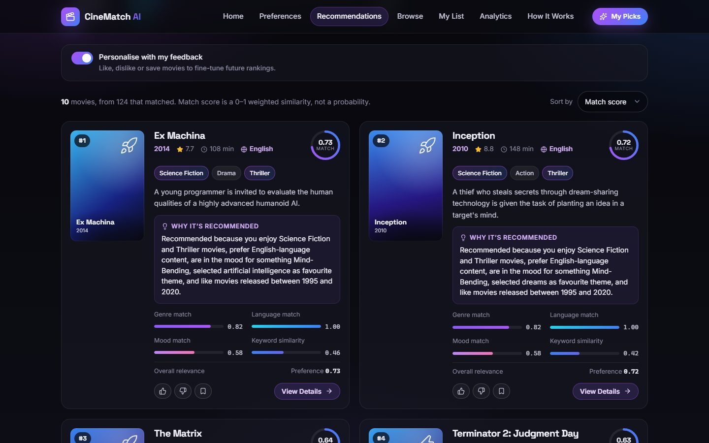
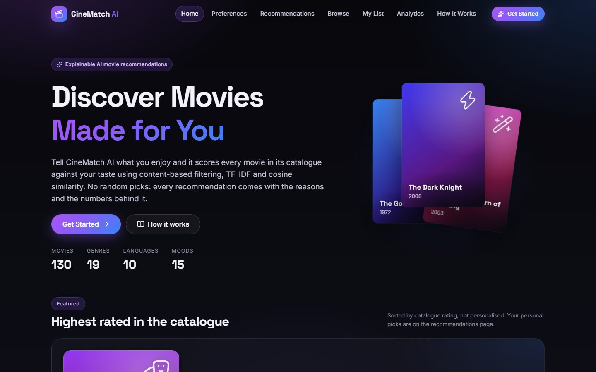
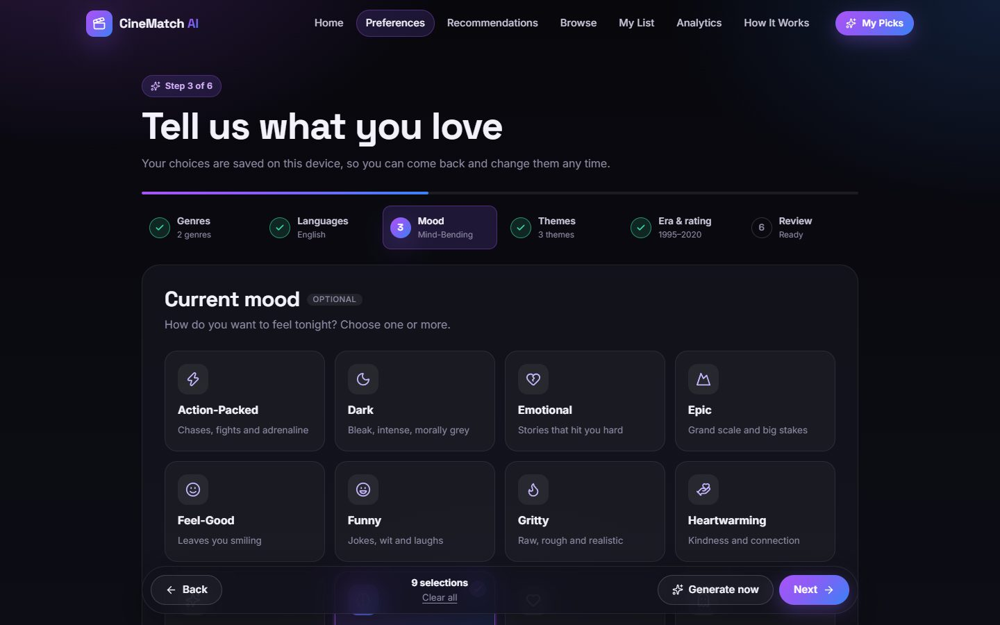
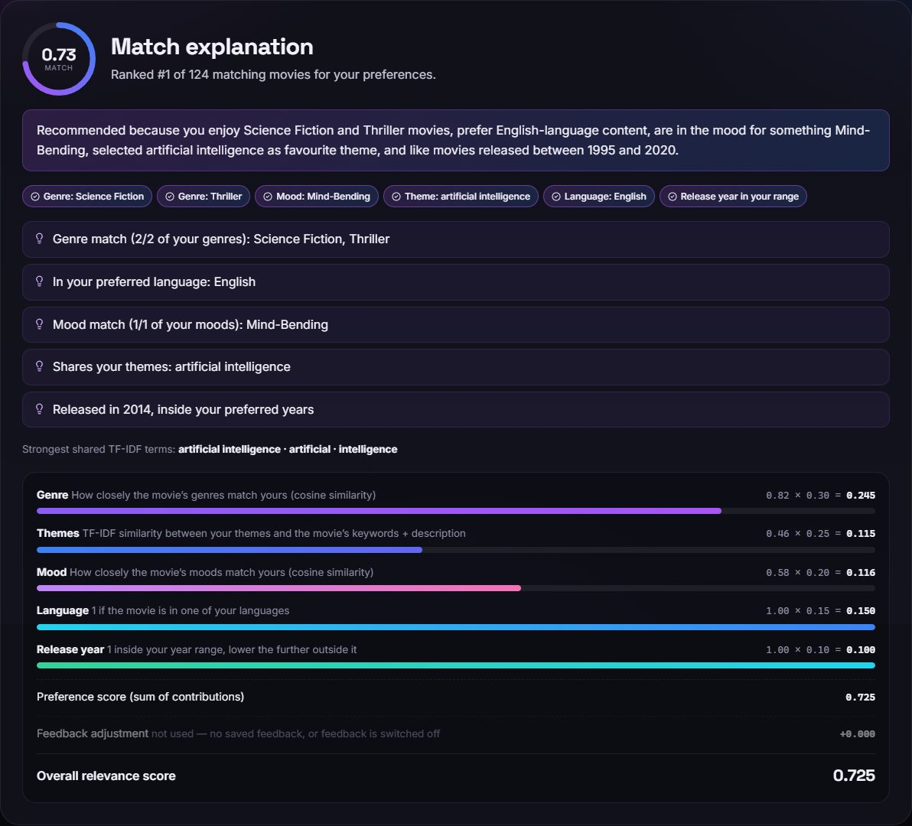
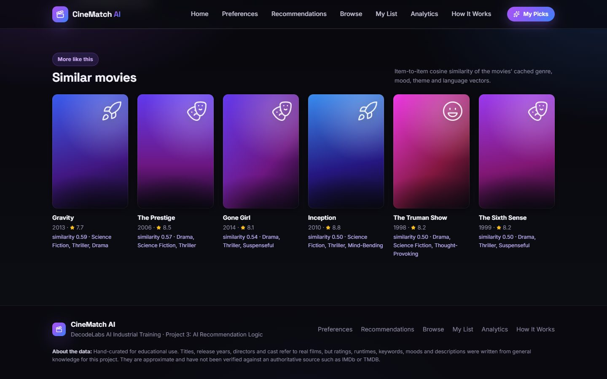
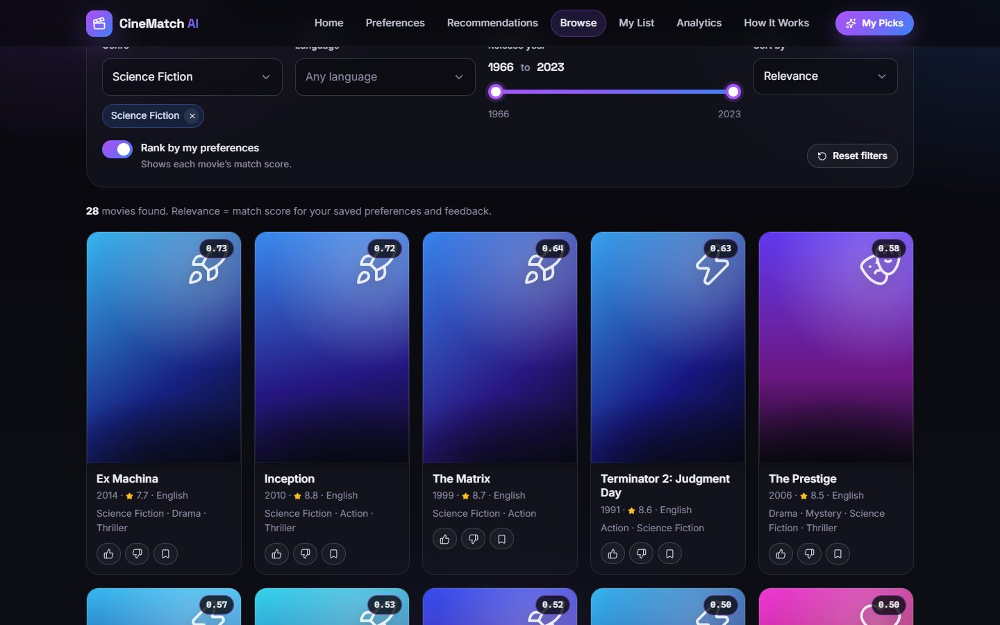
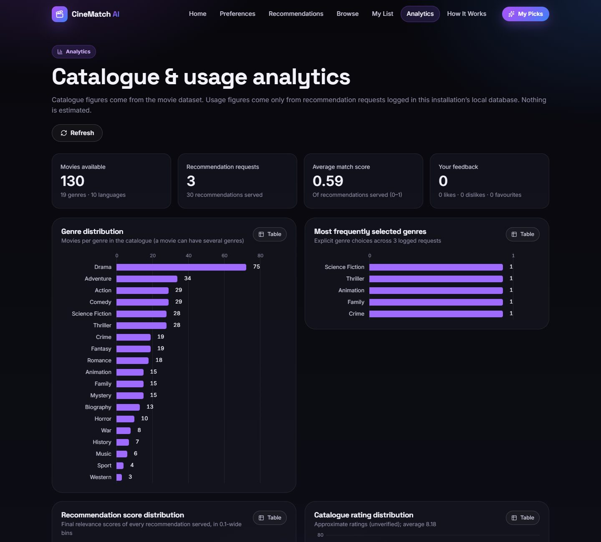
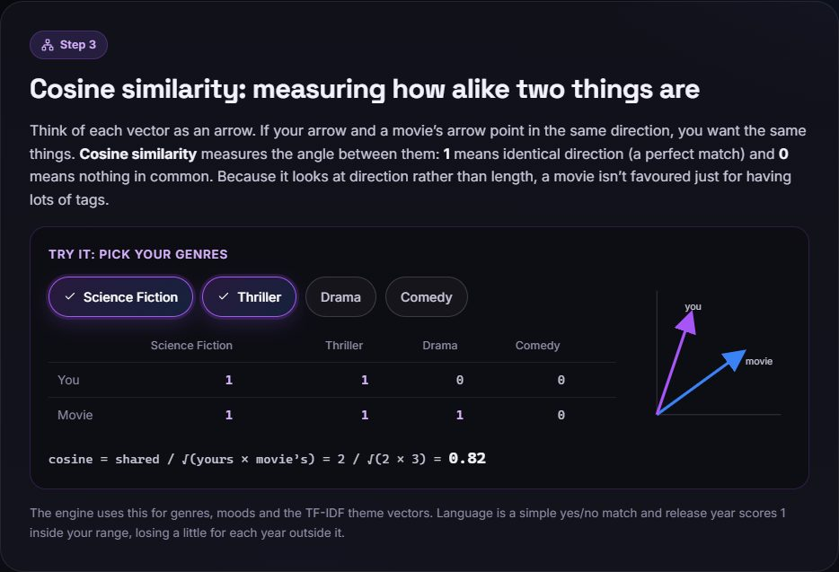
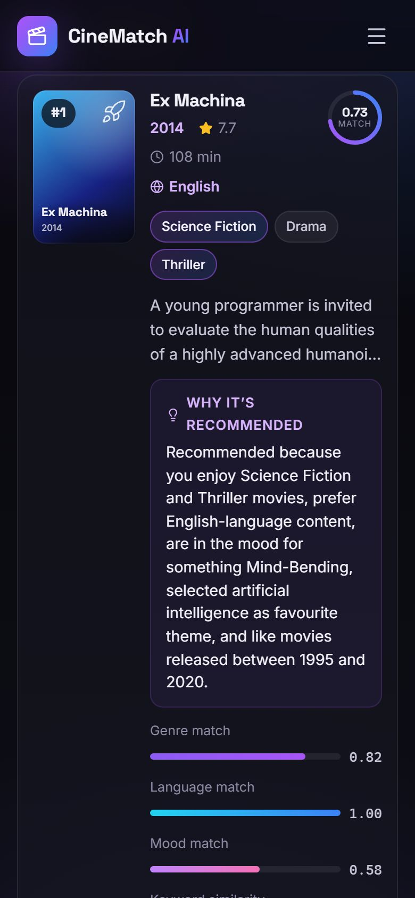

# 🎬 CineMatch AI — Personalized Movie Recommendation System

**DecodeLabs Artificial Intelligence Industrial Training · Project 3: AI Recommendation Logic**

CineMatch AI is a full-stack movie recommender that explains itself. You describe your taste: genres, languages, mood, themes, era, and a minimum rating. The engine then scores every movie in its catalogue with **content-based filtering**, **TF-IDF**, **cosine similarity**, and **weighted preference matching**. You get a ranked list, and each pick says *why* it was chosen, down to the individual score components.

Everything runs locally. There are no paid APIs, no API keys, no external AI services, and no random selection.



---

## Table of Contents

1. [Project Title](#-cinematch-ai--personalized-movie-recommendation-system)
2. [Project Overview](#2-project-overview)
3. [Problem Statement](#3-problem-statement)
4. [Project Objectives](#4-project-objectives)
5. [Features](#5-features)
6. [Technology Stack](#6-technology-stack)
7. [System Architecture](#7-system-architecture)
8. [Recommendation Algorithm](#8-recommendation-algorithm)
9. [Dataset Description](#9-dataset-description)
10. [Folder Structure](#10-folder-structure)
11. [Installation Instructions](#11-installation-instructions)
12. [Backend Setup](#12-backend-setup)
13. [Frontend Setup](#13-frontend-setup)
14. [How to Run the Project](#14-how-to-run-the-project)
15. [API Documentation](#15-api-documentation)
16. [Example User Input](#16-example-user-input)
17. [Example Recommendations](#17-example-recommendations)
18. [Testing Instructions](#18-testing-instructions)
19. [Screenshots](#19-screenshots)
20. [Challenges and Solutions](#20-challenges-and-solutions)
21. [Limitations](#21-limitations)
22. [Future Enhancements](#22-future-enhancements)
23. [Conclusion](#23-conclusion)

---

## 2. Project Overview

CineMatch AI has two parts:

* **A Python / FastAPI backend.** It loads a local movie dataset and turns every movie into numerical feature vectors. It scores those vectors against a user's preferences and returns ranked, explained recommendations through a REST API.
* **A React / Vite frontend.** It collects preferences through a step-by-step form and displays the recommendations with their explanations. It also offers search and filtering, movie details with similar movies, like/dislike/favourite feedback, and an analytics dashboard.

Explainability is the guiding principle. Every number shown in the interface can be traced back to the data and to a formula in this document.

## 3. Problem Statement

Streaming catalogues are large, and choosing what to watch is slow. Many recommenders are black boxes: they say *what* to watch but not *why*. Others rely on the viewing history of many users, which a new user (or a small project) does not have. This is the "cold-start" problem.

This project addresses three questions:

1. How can we recommend movies **from a user's stated preferences alone**, with no history from other users?
2. How can we **measure similarity** between a person's taste and a movie in a principled, mathematical way?
3. How can we make every recommendation **transparent**, so the user understands and trusts the result?

## 4. Project Objectives

* Collect user preferences: genres, languages, mood, themes or keywords, release-year range, and minimum rating.
* Represent each movie as **feature vectors** (content-based filtering).
* Convert descriptions and keywords into numbers with **TF-IDF**.
* Measure the match between the user and each movie with **cosine similarity**.
* Combine several signals with **configurable, normalised weights** into one relevance score.
* **Rank** movies deterministically, apply hard filters correctly, and handle "no match" cases gracefully.
* **Explain** every recommendation: matched attributes, reasons, and every score component.
* Provide a clean, responsive web interface and a documented API, backed by automated tests.

## 5. Features

### Recommendation engine
* Content-based filtering over five components: **genre, keyword/theme, mood, language, and release year**.
* TF-IDF vectorisation of movie keywords and descriptions (scikit-learn).
* Cosine similarity between the user's preferences and each movie.
* **Weighted preference matching** with weights that are configurable per request and re-normalised over the preferences you actually set.
* **Hard filters:** minimum rating (always), plus optional "only these languages" and "only this year range".
* **Deterministic ranking:** score, then rating, then movie id, so ties always resolve the same way.
* **Item-to-item similarity** ("More like this") using a precomputed movie-to-movie cosine matrix.

### Explainable AI
* A **one-sentence summary** built only from attributes that actually matched. For example: *"Recommended because you enjoy Science Fiction and Thriller movies, prefer English-language content, …"*.
* **Score breakdown** for each component (value × weight = contribution), plus the overall relevance score.
* Matched genres, moods, language, keywords, and year are highlighted.
* The strongest shared TF-IDF terms between your themes and the movie.
* An empty result is explained: the response says which filter removed the movies and how many survived each step.

### User feedback & personalisation
* **Like**, **dislike**, and **save to favourites**, stored locally in **SQLite**.
* A **feedback adjustment** that is kept separate from the preference score. Likes and favourites boost similar movies, and dislikes hide a movie and demote similar ones. A toggle restores the preference-only ranking.

### Search, filtering, and discovery
* Title search, filters for genre, language, and release year, and sorting by relevance, rating, year, or title.
* An optional "rank by my preferences" mode that shows each movie's match score.
* Movie details page with keywords, credits, a full match explanation, and similar movies.

### Analytics dashboard
* Catalogue statistics computed from the dataset: genre, language, decade, and rating distributions.
* Usage statistics from the local SQLite log: most frequently selected genres, the distribution of recommendation scores served, and the most-recommended movies.
* The dashboard shows only real data. With no usage yet, the usage charts are empty and say so.

### Engineering quality
* Pydantic request validation. Invalid input gets a clear **422**, never a crash.
* Fitted features are cached on disk (keyed by a hash of the dataset) and component scores are cached in memory, so TF-IDF is not re-fitted on every start.
* Responsive design for desktop, tablet, and phone (down to 360 px wide).
* Offline and error states with retry, and saved preferences that survive a page reload.
* Automated backend (pytest) and frontend (Vitest) test suites.

## 6. Technology Stack

| Layer | Technology |
|---|---|
| Frontend | React 19, React Router 7, Vite 8, JavaScript, plain CSS (no Tailwind), Lucide React icons |
| Backend | Python 3.10+, FastAPI, Uvicorn, Pydantic v2 |
| Machine learning / data | scikit-learn (`TfidfVectorizer`, `MultiLabelBinarizer`, `cosine_similarity`), NumPy, SciPy, Pandas |
| Storage | Local CSV dataset; SQLite (Python standard library) for feedback and usage logs |
| Testing | pytest + FastAPI `TestClient` (backend), Vitest (frontend) |
| Platform | Developed and run on Windows with PowerShell |

## 7. System Architecture

```
┌───────────────────────────── Browser: React + Vite ─────────────────────────────┐
│  Pages: Home · Preferences · Recommendations · Movie Details · Browse ·         │
│         My List · Analytics · How It Works                                      │
│  AppContext (options, saved preferences, cached results, feedback)              │
│  api/client.js ──► fetch('/api/...')                                            │
└──────────────────────────────────────┬──────────────────────────────────────────┘
                                       │  Vite dev proxy: /api → http://127.0.0.1:8000
┌──────────────────────────────────────▼──────────────────────────────────────────┐
│  FastAPI (app/main.py) ── routes.py ── schemas.py (Pydantic validation)         │
│                                                                                 │
│  RecommendationEngine (app/recommender.py), built once at startup               │
│    1. Feature vectors: multi-hot genres & moods, one-hot language,              │
│       TF-IDF of keywords + description, release year                            │
│    2. User profile mapped into the same vector spaces                           │
│    3. Component scores in [0, 1] (cosine similarities, language match, year)    │
│    4. Normalised weighted sum  →  base (preference) score                       │
│    5. Optional feedback adjustment  →  final score                              │
│    6. Hard filters, de-duplication, deterministic ranking                       │
│    7. Explanation: summary, reasons, matched attributes, score breakdown        │
│                                                                                 │
│  data_loader.py ── validates & cleans ──► data/movies.csv                       │
│  store.py ── SQLite ──► feedback + usage log      analytics.py ──► dashboards   │
│  Disk cache (data/.cache) for fitted TF-IDF + similarity matrices               │
└─────────────────────────────────────────────────────────────────────────────────┘
```

**Request flow:** the user submits preferences in the browser, which sends `POST /api/recommendations`. FastAPI validates the body, the engine scores and ranks the movies, and the explained results come back as JSON. The cards then render the summary, the breakdown, and the feedback buttons.

## 8. Recommendation Algorithm

> A more detailed derivation, with a worked example, is in [`docs/ALGORITHM.md`](docs/ALGORITHM.md).

### 8.1 Content-Based Filtering

**Content-based filtering** recommends items that resemble what a user likes, judged by the *content* of the items. Here that means a movie's genres, moods, language, themes, and release year. It needs no history from other users, so it works for a brand-new user on the first request.

For a computer to compare content, every movie becomes a set of **feature vectors**:

| Feature | Encoding | Example (*Inception*) |
|---|---|---|
| Genres | multi-hot vector over the 19 genres | Science Fiction = 1, Action = 1, Thriller = 1, all others = 0 |
| Moods | multi-hot vector over the 15 moods | Mind-Bending = 1, Action-Packed = 1, Thought-Provoking = 1 |
| Language | one-hot vector over the 10 languages | English = 1 |
| Keywords + description | TF-IDF vector over the text vocabulary | weights for "dreams", "heist", "subconscious", … |
| Release year | integer | 2010 |

The user's preferences are mapped into the same spaces, so the two can be compared component by component.

### 8.2 TF-IDF Vectorization

**TF-IDF (Term Frequency – Inverse Document Frequency)** turns text into numbers. A word gets a high weight when it is **frequent in this movie's text** but **rare across the catalogue**, which is exactly what makes a word *distinctive*.

For a term $t$ in a movie document $d$, among $N$ movies:

$$\mathrm{tf}(t,d) = 1 + \ln\big(\text{count}(t,d)\big) \qquad \text{(sublinear term frequency)}$$

$$\mathrm{idf}(t) = \ln\!\left(\frac{1 + N}{1 + \mathrm{df}(t)}\right) + 1 \qquad \text{(smoothed inverse document frequency)}$$

$$\text{tfidf}(t,d) = \mathrm{tf}(t,d)\cdot \mathrm{idf}(t), \qquad \text{then each movie vector is L2-normalised}$$

where $\mathrm{df}(t)$ is the number of movies whose text contains $t$. These are scikit-learn's `TfidfVectorizer(sublinear_tf=True)` defaults, with English stop words removed.

Each movie's document is its **keywords** plus its **description**. Multi-word keywords are also added as a single joined token, repeated twice (`time travel` → `timetravel timetravel time travel`). A theme like *time travel* therefore stays one strong feature instead of matching every description that merely mentions *time*.

### 8.3 Cosine Similarity

**Cosine similarity** measures how closely two vectors point in the same direction:

$$\cos(\mathbf{u},\mathbf{m}) = \frac{\mathbf{u}\cdot\mathbf{m}}{\lVert\mathbf{u}\rVert\,\lVert\mathbf{m}\rVert} = \frac{\sum_i u_i m_i}{\sqrt{\sum_i u_i^2}\,\sqrt{\sum_i m_i^2}}$$

With non-negative vectors, the result lies in $[0, 1]$: **1** means the same direction (a perfect match), and **0** means nothing in common. Because it depends on direction rather than length, a movie is not favoured just for having many tags.

For multi-hot genre or mood vectors, cosine has a simple form. $U$ is the set of user genres and $M$ is the set of movie genres:

$$\cos(U, M) = \frac{|U \cap M|}{\sqrt{|U|\cdot|M|}}$$

*Example:* the user picks {Science Fiction, Thriller} and *Ex Machina* is {Science Fiction, Drama, Thriller}, so $\cos = 2/\sqrt{2 \cdot 3} \approx 0.817$.

### 8.4 Weighted Preference Matching

Each movie $m$ gets five **component scores**, all in $[0,1]$:

| Component | Formula | Default weight $w_c$ |
|---|---|---|
| Genre $s_{\text{genre}}$ | $\cos(U_{\text{genres}}, M_{\text{genres}})$ | 0.30 |
| Keyword $s_{\text{keyword}}$ | $\dfrac{\cos(\text{tfidf}_{\text{user}}, \text{tfidf}_m)}{\max_{m'} \cos(\text{tfidf}_{\text{user}}, \text{tfidf}_{m'})}$ | 0.25 |
| Mood $s_{\text{mood}}$ | $\cos(U_{\text{moods}}, M_{\text{moods}})$ | 0.20 |
| Language $s_{\text{language}}$ | $1$ if the movie's language was selected, else $0$ | 0.15 |
| Year $s_{\text{year}}$ | $\max\!\big(0,\; 1 - d/20\big)$, where $d$ = years outside the chosen range | 0.10 |

The keyword score is **max-normalised**: the best text match in the catalogue scores 1. Raw TF-IDF cosines are small, rarely above 0.5, so without this the keyword weight would have little effect next to genre and mood scores that can reach 1.

Only components the user actually set are **active**. Their weights are re-normalised to sum to 1:

$$w'_c = \frac{w_c}{\sum_{k \in \text{active}} w_k} \qquad\qquad \text{base}(m) = \sum_{c \in \text{active}} w'_c \cdot s_c(m)$$

A user who picks only genres is therefore scored purely on genre, and the score is not capped at 0.30. Weights can be changed per request; a request whose active weights are all zero is rejected.

**Optional feedback adjustment.** This is kept separate from the preference score. $\text{sim}$ is the item-to-item cosine similarity, and a movie never counts its own feedback:

$$\text{adj}(m) = 0.15\cdot\Big(\max_{j \in \text{liked} \cup \text{favourites}} \text{sim}(m,j) \;-\; \max_{j \in \text{disliked}} \text{sim}(m,j)\Big)$$

$$\text{score}(m) = \text{clip}\big(\text{base}(m) + \text{adj}(m),\; 0,\; 1\big)$$

> **Note:** the score is a **weighted similarity used for ranking**. It is **not** a probability that you will enjoy the movie, and the interface labels it as a 0–1 relevance score.

### 8.5 Recommendation Ranking

1. **Hard filters:** remove movies below the minimum rating. If the "only these languages" or "only this year range" switches are on, also remove movies outside them. A preference used as a hard filter is not scored as well, because it would add the same 1.0 to every remaining movie. The exception is when it is your only preference.
2. **Exclusions:** remove the "movies you love" that seeded the profile, any explicitly excluded movies, and movies you disliked.
3. **Drop non-matches:** remove movies whose preference score is 0. Feedback can only re-rank movies that match a preference; it cannot pull in unrelated ones.
4. **Sort deterministically:** by **score ↓**, then **rating ↓**, then **movie id ↑**. Scores are rounded before sorting, so floating-point noise can never reorder genuinely equal scores.
5. **Return the top N** (10 by default). If nothing survives, the response is still `200`, with an empty list, a `message` naming the filter responsible, and a `filter_report` with the count after each step.

## 9. Dataset Description

`backend/data/movies.csv` contains **130 movies** spanning **19 genres**, **15 moods**, and **10 languages**, released between **1966 and 2023**.

| Column | Type | Description |
|---|---|---|
| `movie_id` | integer | Unique identifier |
| `title` | text | Movie title |
| `year` | integer | Release year |
| `genres` | pipe-separated list | e.g. `Science Fiction\|Action\|Thriller` |
| `director` | text | Director |
| `cast` | pipe-separated list | Main cast |
| `keywords` | pipe-separated list | Themes and plot elements, e.g. `dreams\|heist\|reality` |
| `moods` | pipe-separated list | e.g. `Mind-Bending\|Action-Packed` |
| `overview` | text | One-sentence description |
| `rating` | decimal (0–10) | Approximate rating |
| `runtime` | integer (minutes) | Duration |
| `language` | text | Original language |

Languages in the catalogue: English (104), Hindi (10), Japanese (4), Korean (3), French (2), Italian (2), Telugu (2), Mandarin (1), Portuguese (1), Spanish (1).

> **Data provenance: please read.** The catalogue is **hand-curated for educational use and is not verified.** Titles, release years, directors, and cast refer to real films. The ratings, runtimes, keywords, moods, and descriptions were written from general knowledge for this project. They are **approximate** and have **not** been checked against an authoritative source such as IMDb or TMDB. The same note is returned by `GET /api/dataset` and shown in the app footer. The automated tests use a separate, clearly **synthetic** seven-movie fixture.

**Data cleaning.** The loader never invents values:

* Rows missing a valid id, title, year (1880–2100), or rating (0–10) are dropped and logged by reason.
* Missing optional fields get explicit empty values. Genres, moods, keywords, and cast become empty lists. Director and language become "Unknown", and the overview becomes empty.
* An unknown runtime is stored as 0 and shown as "Runtime —".
* Duplicate ids, and duplicate title-and-year pairs, are removed.

## 10. Folder Structure

```
CineMatch-AI/
├── backend/
│   ├── app/
│   │   ├── main.py            # FastAPI app, startup, CORS
│   │   ├── routes.py          # REST endpoints
│   │   ├── schemas.py         # Pydantic request/response models
│   │   ├── recommender.py     # RecommendationEngine: features, scoring, ranking, explanations, search
│   │   ├── data_loader.py     # CSV loading, validation, cleaning, de-duplication
│   │   ├── store.py           # SQLite: feedback + anonymous usage log
│   │   ├── analytics.py       # analytics payload (dataset + logged usage)
│   │   ├── config.py          # weights, paths, cache settings, dataset provenance
│   │   └── demo.py            # command-line demo with a sample input
│   ├── data/movies.csv        # the movie catalogue
│   ├── tests/                 # pytest suites (synthetic fixture + real dataset)
│   ├── requirements.txt       # runtime dependencies
│   ├── requirements-dev.txt   # + pytest, httpx
│   └── pytest.ini
├── frontend/
│   ├── index.html
│   ├── vite.config.js         # dev server + /api proxy (API_TARGET env var)
│   ├── package.json
│   └── src/
│       ├── main.jsx, App.jsx  # entry point and routes
│       ├── api/client.js      # backend API wrapper
│       ├── context/           # AppContext: options, preferences, results, feedback
│       ├── pages/             # Home, Preferences, Results, MovieDetails, Browse,
│       │                      # MyList, Analytics, HowItWorks, NotFound
│       ├── components/        # layout/, ui/, movies/, preferences/, charts/
│       ├── utils/             # preference validation, storage, formatting, teaching TF-IDF
│       ├── hooks/             # useDebounce
│       ├── styles/            # tokens, base, layout, components, pages, features (.css)
│       └── __tests__/         # Vitest unit tests
├── docs/
│   ├── ALGORITHM.md           # detailed algorithm walkthrough
│   └── screenshots/           # screenshots used in this README
├── scripts/                   # Windows PowerShell setup / start helpers
└── README.md
```

## 11. Installation Instructions

**Prerequisites**

* **Python 3.10 or newer** ([python.org](https://www.python.org/downloads/))
* **Node.js 20 or newer** ([nodejs.org](https://nodejs.org/))
* Windows PowerShell (the commands below use it)

Clone the repository:

```powershell
git clone https://github.com/SRBaggari/CineMatch-AI.git
cd CineMatch-AI
```

**One-step setup (recommended).** This creates the Python virtual environment, installs the backend packages, and installs the frontend packages:

```powershell
powershell -ExecutionPolicy Bypass -File .\scripts\setup.ps1
```

You can also follow sections 12 and 13 to set up each part by hand.

## 12. Backend Setup

```powershell
cd backend
python -m venv .venv
.\.venv\Scripts\python.exe -m pip install -r requirements-dev.txt
```

`requirements.txt` holds the runtime packages: FastAPI, Uvicorn, Pydantic, Pandas, NumPy, scikit-learn, and SciPy. `requirements-dev.txt` adds pytest and httpx for testing.

**Optional environment variables**

| Variable | Default | Purpose |
|---|---|---|
| `CINEMATCH_DB_PATH` | `backend/data/cinematch.db` | SQLite file for feedback and usage logs |
| `CINEMATCH_CACHE_DIR` | `backend/data/.cache` | Disk cache for fitted features (empty string disables it) |

Both the database and the cache are created automatically and are ignored by git.

## 13. Frontend Setup

```powershell
cd frontend
npm install
```

During development the frontend calls relative `/api/...` URLs, and Vite proxies them to the backend. To point the proxy at a different backend port, set `API_TARGET` before starting the dev server:

```powershell
$env:API_TARGET = "http://127.0.0.1:8001"
```

## 14. How to Run the Project

**Option A: one command (two windows open)**

```powershell
powershell -ExecutionPolicy Bypass -File .\scripts\start-all.ps1
```

**Option B: two terminals**

```powershell
# Terminal 1: backend (http://127.0.0.1:8000, interactive API docs at /docs)
cd backend
.\.venv\Scripts\python.exe -m uvicorn app.main:app --reload --port 8000

# Terminal 2: frontend (http://localhost:5173)
cd frontend
npm run dev
```

Open **http://localhost:5173** in your browser.

**If port 8000 is already in use**, run the backend on another port and point the frontend at it:

```powershell
powershell -ExecutionPolicy Bypass -File .\scripts\start-all.ps1 -Port 8001
```

**Command-line demo:** this prints a sample input, its score components, and the ranked results without starting the web app:

```powershell
cd backend
.\.venv\Scripts\python.exe -m app.demo
```

**Production build of the frontend:**

```powershell
cd frontend
npm run build      # output in frontend/dist
npm run preview    # serves the build on http://localhost:4173 (still proxies /api)
```

## 15. API Documentation

When the backend is running, interactive Swagger documentation is available at **http://127.0.0.1:8000/docs**.

| Method | Endpoint | Description |
|---|---|---|
| GET | `/api/health` | Service status and number of movies loaded |
| GET | `/api/dataset` | Catalogue size, vocabulary size, and provenance note |
| GET | `/api/preferences/options` | Available genres, moods, languages, popular keywords, year and rating ranges, default weights |
| GET | `/api/movies?search=&genre=&language=&limit=&offset=` | Paginated movie list |
| GET | `/api/movies/{id}` | Movie details |
| GET | `/api/movies/{id}/similar?top_n=` | Item-to-item similar movies |
| POST | `/api/movies/search` | Title search with genre, language, and year filters; sort by `relevance`, `rating`, `year`, or `title` |
| POST | `/api/recommendations` | Ranked, explained recommendations |
| POST | `/api/movies/{id}/explain` | Score, rank, and explanation of **one** movie for the given preferences |
| GET | `/api/feedback` | Saved likes, dislikes, and favourites |
| PUT | `/api/feedback/{id}` | Set a reaction (`like` / `dislike` / `null`) and/or `favorite` (true/false) |
| DELETE | `/api/feedback/{id}` · `/api/feedback` | Clear one movie's feedback, or all of it |
| GET | `/api/analytics` | Catalogue distributions, logged usage, and feedback counts |

**`POST /api/recommendations`: request body.** Every field is optional, but at least one preference is required:

| Field | Type | Notes |
|---|---|---|
| `genres`, `languages`, `moods`, `keywords` | list of strings (max 20) | Unknown genres, moods, or languages return 422 |
| `liked_movie_ids`, `exclude_movie_ids` | list of ids | "Movies you love" seed the profile and are excluded from results |
| `year_min`, `year_max` | integer | Preferred release-year range |
| `min_rating` | number 0–10 | Always a hard filter |
| `strict_years`, `strict_languages` | boolean | Turn the year range or languages into hard filters |
| `top_n` | integer 1–50 | Default 10 |
| `weights` | object | `genre`, `keyword`, `mood`, `language`, `year` (non-negative; re-normalised) |
| `use_feedback` | boolean | Default `true`; apply saved likes, dislikes, and favourites |

**Response.** The response contains `recommendations` (see section 17). It also includes `profile` (the effective weights, active components, and any genres or moods inferred from liked movies), a `filter_report` (movies remaining after each filter), `message` (an explanation when the list is empty), and `warnings`.

**Errors.** Validation problems return **422** with a readable `detail`. Examples include empty preferences, out-of-range values, `year_min > year_max`, unknown labels or ids, unknown fields, and all-zero weights. A missing movie returns **404**.

## 16. Example User Input

The same request is used by `python -m app.demo` and in the screenshots:

```json
POST /api/recommendations
{
  "genres": ["Science Fiction", "Thriller"],
  "languages": ["English"],
  "moods": ["Mind-Bending"],
  "keywords": ["time travel", "dreams", "artificial intelligence"],
  "year_min": 1995,
  "year_max": 2020,
  "min_rating": 7.5
}
```

All five components are active, so the default weights are used unchanged: genre 0.30, keyword 0.25, mood 0.20, language 0.15, and year 0.10. The minimum rating removes 5 movies (130 → 125). Of the remaining movies, 124 match at least one preference.

## 17. Example Recommendations

The output below was produced by the application for the input above (`python -m app.demo` and `POST /api/recommendations`):

| # | Movie | Genre | Language | Mood | Keyword (raw cosine) | Year | **Score** |
|---|---|---|---|---|---|---|---|
| 1 | Ex Machina | 0.817 | 1.000 | 0.577 | 0.460 (0.192) | 1.000 | **0.725** |
| 2 | Inception | 0.817 | 1.000 | 0.577 | 0.425 (0.178) | 1.000 | **0.717** |
| 3 | The Matrix | 0.500 | 1.000 | 0.577 | 0.479 (0.200) | 1.000 | **0.635** |
| 4 | Terminator 2: Judgment Day | 0.500 | 1.000 | 0.000 | 1.000 (0.418) | 0.800 | **0.630** |
| 5 | The Prestige | 0.707 | 1.000 | 0.577 | 0.000 (0.000) | 1.000 | **0.578** |

**How the top score is calculated (*Ex Machina*):**

$$0.30(0.817) + 0.15(1.000) + 0.20(0.577) + 0.25(0.460) + 0.10(1.000) = 0.245 + 0.150 + 0.116 + 0.115 + 0.100 = 0.725$$

**Explanation returned for #1:**

> *Recommended because you enjoy Science Fiction and Thriller movies, prefer English-language content, are in the mood for something Mind-Bending, selected artificial intelligence as favourite theme, and like movies released between 1995 and 2020.*
>
> Shared TF-IDF terms: *artificial intelligence, artificial, intelligence*

Some details worth noticing:

* **#4, Terminator 2:** it has the best text match (both *time travel* and *artificial intelligence*), so its keyword score is exactly 1.0. It was released in 1991, four years before the range, so its year score is 1 − 4/20 = 0.8, and its summary leaves the year out.
* **#5, The Prestige:** it has no keyword match, and its explanation does not claim one.

**Similar movies to *Ex Machina*** (item-to-item cosine): Gravity (0.587), The Prestige (0.570), Gone Girl (0.542).

## 18. Testing Instructions

```powershell
# Backend: unit, engine, API, and regression tests
cd backend
.\.venv\Scripts\python.exe -m pytest -v

# Frontend: Vitest unit tests
cd frontend
npm test
```

**What the tests cover**

| Suite | Covers |
|---|---|
| `tests/test_scoring.py` | Pure maths: set cosine, year score, weight normalisation, token handling |
| `tests/test_engine.py` | Exact, partial, and no matches; empty and invalid preferences; duplicates; ranking; determinism; tie-breaking |
| `tests/test_features.py` | Explanation summaries, feedback adjustment, search and filters, similar movies, caching |
| `tests/test_store_and_api_features.py` | SQLite store, feedback / search / analytics endpoints |
| `tests/test_api.py` | Endpoints and invalid input against the real dataset |
| `tests/test_audit_regressions.py` | Missing-value datasets, user scenarios, concurrency, and regressions found during QA |
| `frontend/src/__tests__/` | Preference validation, active-weight rules, API error handling, the teaching TF-IDF maths |

Engine tests use a small **synthetic** seven-movie catalogue with hand-checkable properties. For example, three movies with identical content but different ratings and ids verify the tie-breaking order. API tests use a temporary database, so they never touch your saved feedback.

When this README was written, the suites contained 138 backend tests and 22 frontend tests, and all of them passed. Run the commands above to verify on your machine.

## 19. Screenshots

All screenshots were captured from the running application. The analytics screenshot shows the usage logged during that capture session (three recommendation requests).

| | |
|---|---|
| **Home**<br> | **Preferences: mood step**<br> |
| **Recommendations**<br> | **Match explanation (movie details)**<br> |
| **Similar movies**<br> | **Browse: search & filters**<br> |
| **Analytics dashboard**<br> | **How It Works: interactive cosine demo**<br> |

**Mobile (390 px wide)**



## 20. Challenges and Solutions

| Challenge | Solution |
|---|---|
| **Scores on different scales.** Raw TF-IDF cosines rarely exceed 0.5, while genre and mood cosines reach 1, so the keyword weight had little effect. | Max-normalise the keyword score over the catalogue, so the best text match scores 1. The raw cosine is still reported in the API. |
| **Multi-word themes matched too loosely.** Treated as separate words, "time travel" matched any description mentioning "time". | Add each keyword as a single joined token (`timetravel`, weighted twice) for exact concept matching, while also keeping the raw words. |
| **Strict filters inflated scores.** When "only these languages" is on, every remaining movie scores 1.0 on language. That raised scores and let movies matching nothing else rank. | Switch off the scoring of a component when it is used as a hard filter, unless it is the only preference. |
| **Ties must be deterministic.** Equal scores could come out in any order. | Round scores, then sort by score, rating, and movie id. Dedicated tests check the order. |
| **Feedback could hide the reason for a pick.** Mixing likes into one number would make results hard to explain. | Keep `base_score` and `feedback_adjustment` separate, bound the adjustment to ±0.15, and only re-rank movies that already match a preference. |
| **Messy data.** Missing titles or years were silently turned into "nan" or 0. | Validate on load: drop rows missing identity or ranking fields, give optional fields explicit empty values, and log what was dropped. Covered by regression tests. |
| **Speed.** Profiling showed most request time was spent building explanations, not scoring. | Cache fitted features on disk and component scores in memory, precompute per-movie data, and read sparse TF-IDF rows directly. |
| **Bugs that only appear in a real browser.** One example: an effect returning the Promise from `window.scrollTo()` crashed every page in Edge. | Test end to end in a real browser at desktop, tablet, and phone widths, including taking the backend offline mid-session. |
| **Avoiding misleading numbers.** A "95% match" reads like a probability. | Show the score as a 0–1 relevance score, explicitly labelled as not a probability. |

## 21. Limitations

* **Small, unverified catalogue.** There are 130 hand-curated movies with approximate metadata (see the provenance note in section 9). Results can only be as good as the catalogue.
* **Vocabulary, not meaning.** TF-IDF matches words, so *spaceship* and *starship* are unrelated features. Synonyms and paraphrases are not understood.
* **Weights set by judgement.** The default weights, the 20-year decay, and the ±0.15 feedback bound were chosen by reasoning, not learned from user behaviour.
* **No offline evaluation metrics.** The project has no ground-truth user ratings, so no accuracy, precision, or recall figures are reported.
* **Single local profile.** There are no user accounts. Feedback and usage logs belong to whoever uses the installation.
* **"More of the same".** Content-based filtering tends to recommend items similar to what you already chose, and there is no diversity re-ranking yet.
* **Generated posters.** Posters are produced from genre colours rather than real artwork, because the project uses no external image services.

## 22. Future Enhancements

* Semantic text matching with sentence embeddings to capture meaning and synonyms, alongside TF-IDF.
* Learning component weights from collected feedback, and evaluating with held-out ratings (precision@k, NDCG).
* A diversity-aware re-ranking step, such as Maximal Marginal Relevance (MMR).
* Hybrid recommendations: adding collaborative filtering once multiple user profiles exist.
* User accounts with separate profiles and feedback.
* A larger, verified dataset imported from an open, licensed source.
* An end-to-end browser test suite in CI.

## 23. Conclusion

CineMatch AI shows that a transparent, mathematically grounded recommender can be built without external AI services or user-history data.

* **Representation:** each movie is a set of feature vectors.
* **Text:** keywords and descriptions are weighted with TF-IDF.
* **Similarity:** taste and content are compared with cosine similarity.
* **Scoring:** the signals are combined with normalised, configurable weights.
* **Ranking:** results are ordered deterministically.

The system meets every objective of *Project 3: AI Recommendation Logic*. Most importantly, it **explains every recommendation** in plain language and in numbers, so a user can see exactly why a movie was suggested. It also leaves clear paths for future work: semantic matching, learned weights, and evaluation with real users.

---

*Built for the DecodeLabs Artificial Intelligence Industrial Training programme.*
